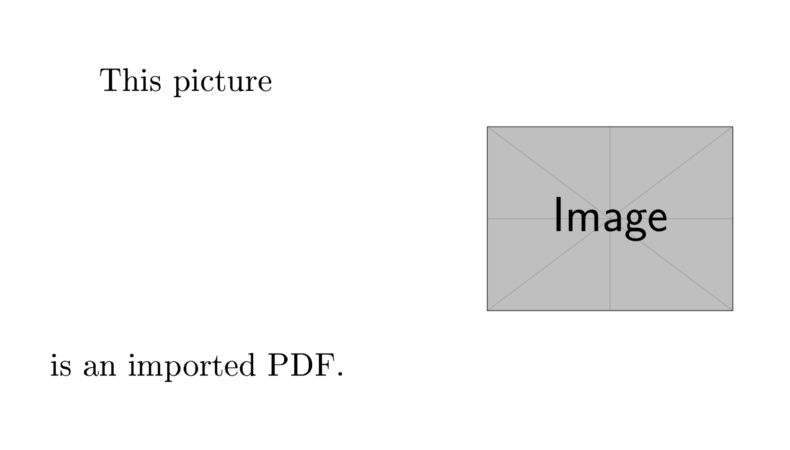
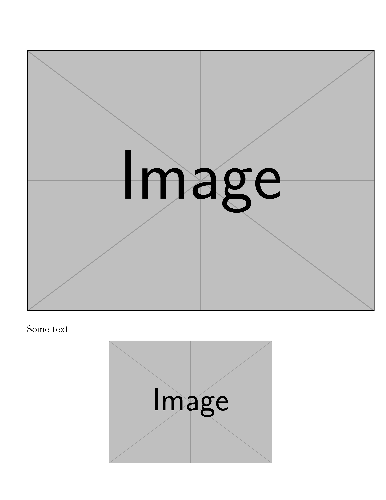
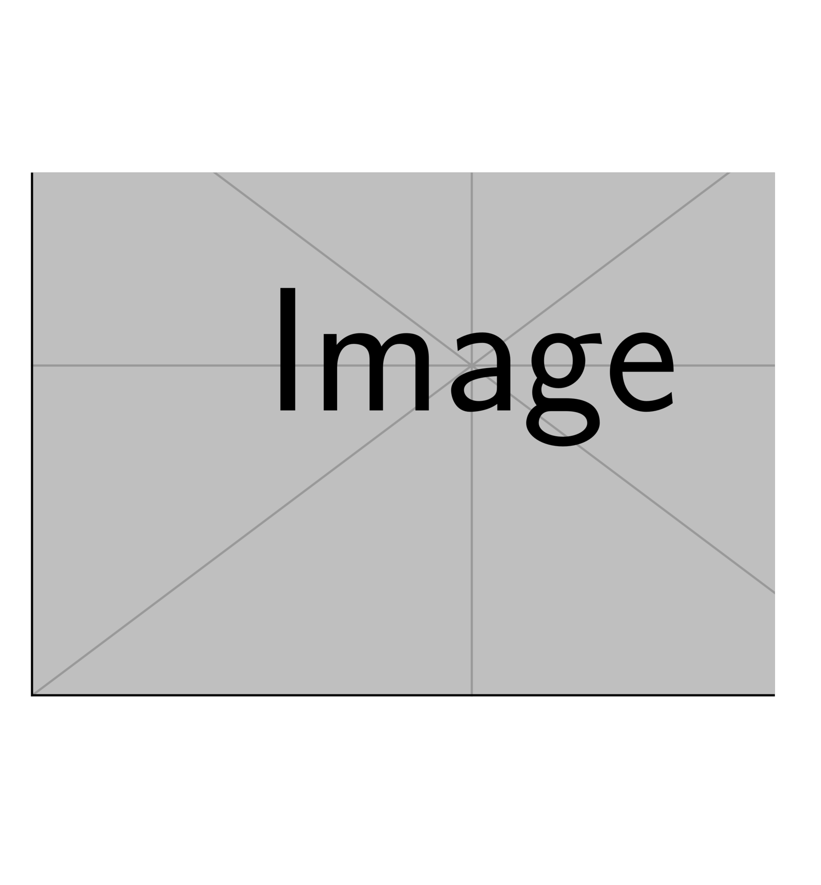
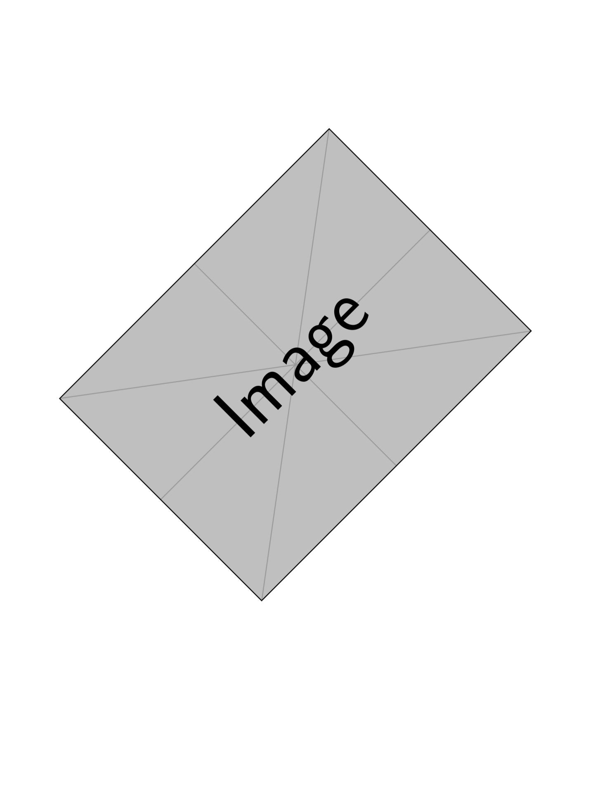
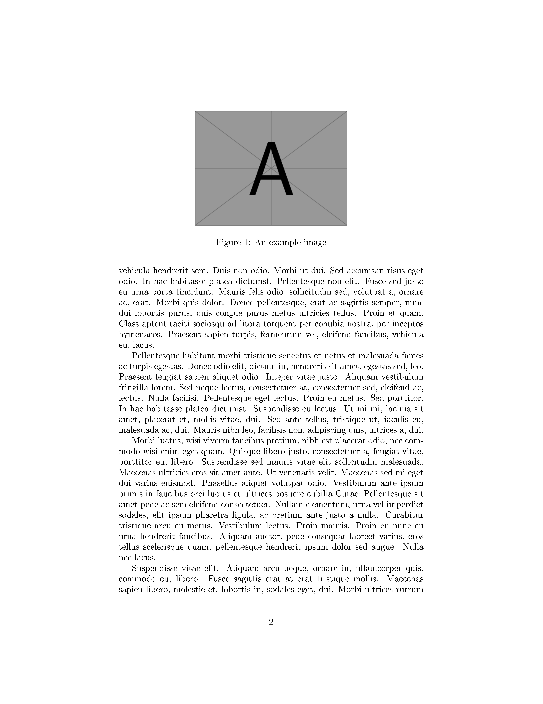
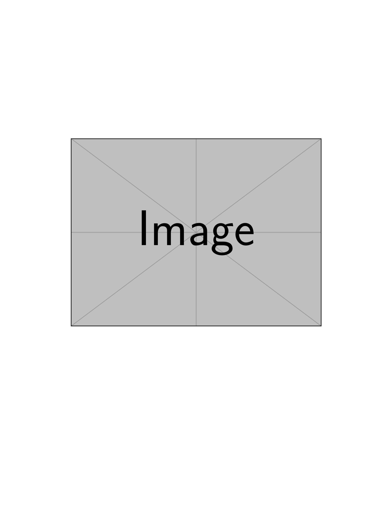
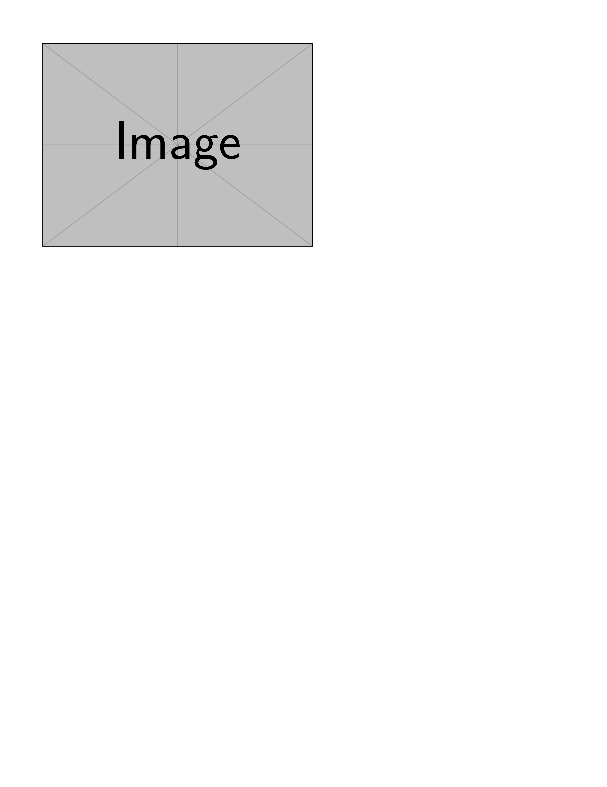
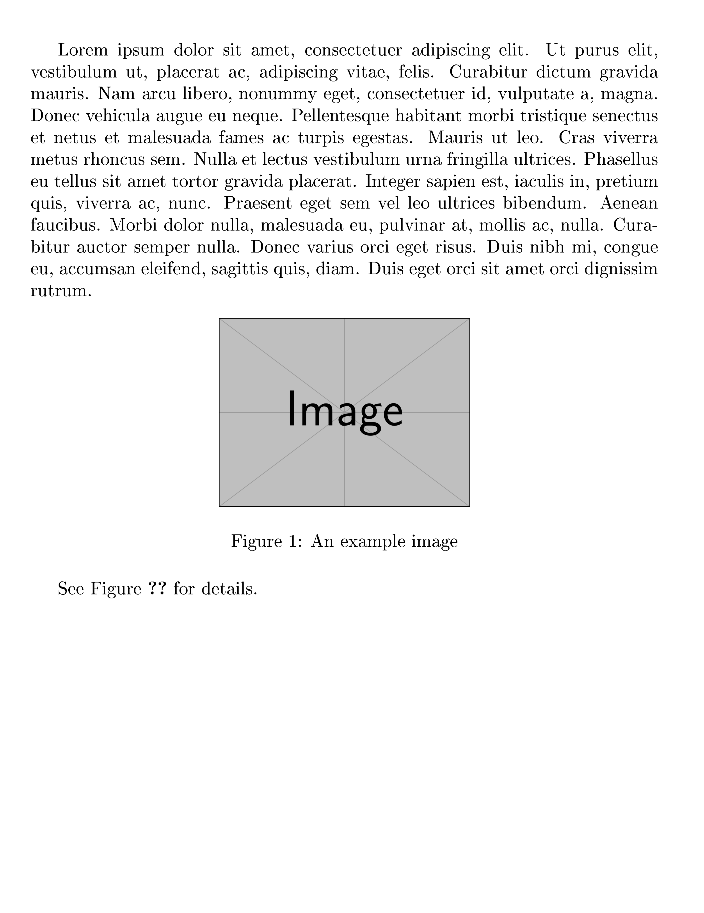

---
## Author
author:
  name: Ван Яо
  degrees: MSc
  email: 1132259420@rudn.ru
  affiliation:
    - name: Российский университет дружбы народов
      department: Группа НФИмд-01-25
      country: Российская Федерация
      postal-code: 117198
      city: Москва
      address: ул. Миклухо-Маклая, д. 6

## Title
title: "Лабораторная работа №4"
subtitle: "Включение графики в LaTeX"
license: "CC BY"
date: today
date-format: "YYYY-MM-DD"
---


# Информация

## Докладчик

:::::::::::::: {.columns align=center}
::: {.column width="70%"}

  * Ван Яо
  * Студент ФФМиЕН
  * Российский университет дружбы народов им. П. Лумумбы
  * [1132259420@rudn.ru](mailto:1132259420@rudn.ru)

:::

::: {.column width="30%"}

{width=70%}

:::
::::::::::::::

# Вводная часть

## Цели и задачи

- Цель:
    - изучить способы включения графики в документ LaTeX
- Задачи:
    - базовые команды пакета `graphicx`
    - изменение параметров (размер, обрезка, поворот)
    - плавающие объекты (floats) и их размещение
    - механизм перекрёстных ссылок (`\label` и `\ref`)
    - хранение графики в подкаталогах

## Пакет graphicx

- Для вставки используется пакет `graphicx` и команда `\includegraphics`
- Поддерживаются форматы: EPS, PNG, JPG, PDF
- Управление размером: `width`, `height`, `scale` (с сохранением пропорций)
- Обрезка (`clip`, `trim`) и поворот (`angle`)

# Ход выполнения работы

## Базовое включение и размеры

```tex
\usepackage{graphicx}
\includegraphics[height=2cm]{example-image}
```

{width=45%}
{width=45%}


## Обрезка и поворот

- Обрезка с помощью `clip` и `trim`
- Поворот через параметр `angle`

```tex
\includegraphics[angle=45, width=0.4\textwidth]{example-image}
```

{width=45%}
{width=45%}


## Плавающие объекты (floats)

- Изображения обычно помещают в окружение `figure`
- LaTeX сам оптимизирует положение объекта
- Параметры размещения: `h` (here), `t` (top), `b` (bottom), `p` (page)

```tex
\begin{figure}[ht]
\centering
\includegraphics[width=0.5\textwidth]{example-image}
\caption{An example image}
\end{figure}
```

{width=60%}

## Строгое размещение и пользовательские floats

- Пакет `float` и параметр `[H]` для строгого размещения
- Пакет `trivfloat` для создания новых типов окружений

```tex
\usepackage{float}
\begin{figure}[H] ...
```

{width=45%}
{width=45%}

## Пути к файлам

- Именование файлов без пробелов
- Настройка путей поиска с помощью `\graphicspath`

```tex
\graphicspath{{figs/}{pics/}}
```

{width=60%}

## Перекрёстные ссылки

- Использование `\label` и `\ref`
- Важно: требуется двойная компиляция для обновления ссылок
- `hyperref` делает ссылки кликабельными

```tex
\label{fig:example}
See Figure~\ref{fig:example}
```

{width=45%}
{width=45%}


# Заключение

## Заключение

- Изучили базовые команды вставки графики (`graphicx`)
- Освоили управление размером, обрезку и поворот
- Разобрали работу с плавающими объектами (`figure`, `float`, `trivfloat`)
- Научились создавать перекрёстные ссылки (`\label`, `\ref`) и гиперссылки (`hyperref`)
```