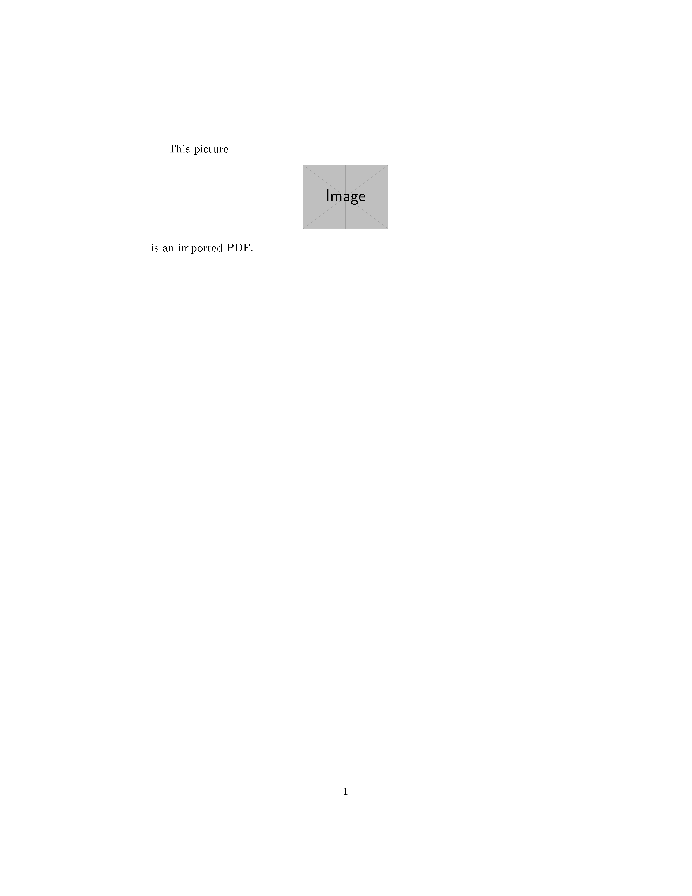
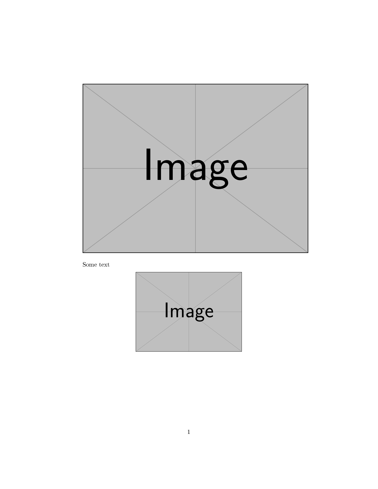
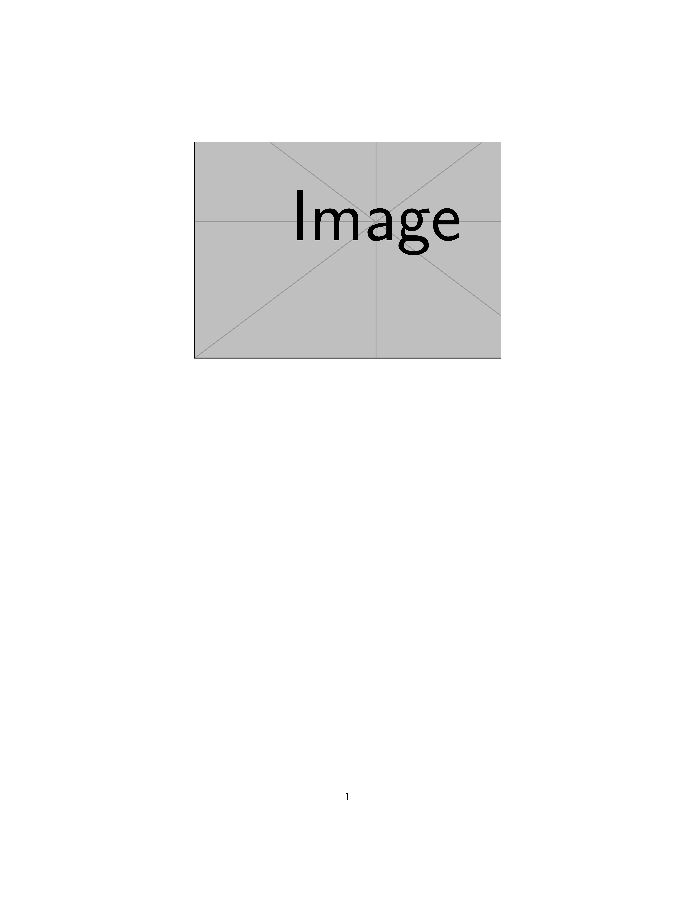
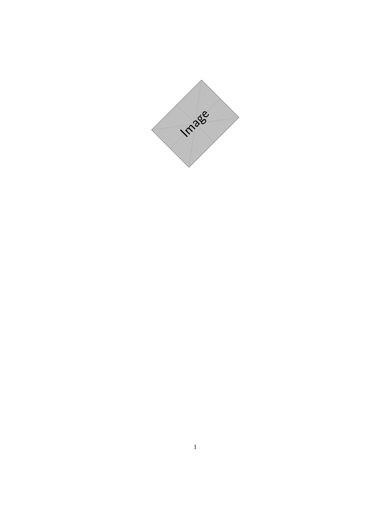
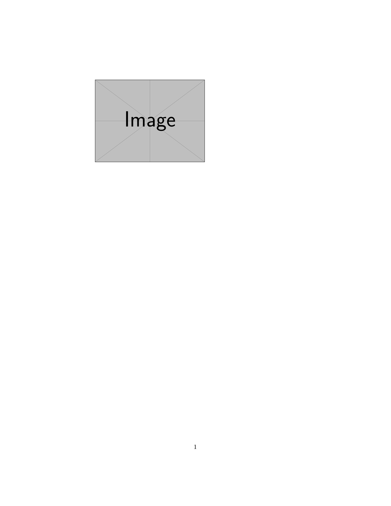
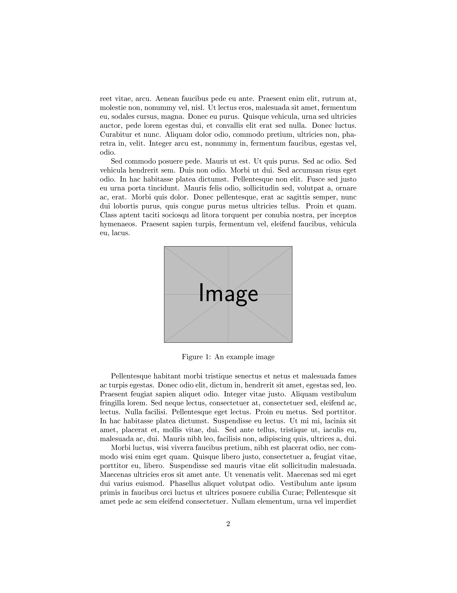
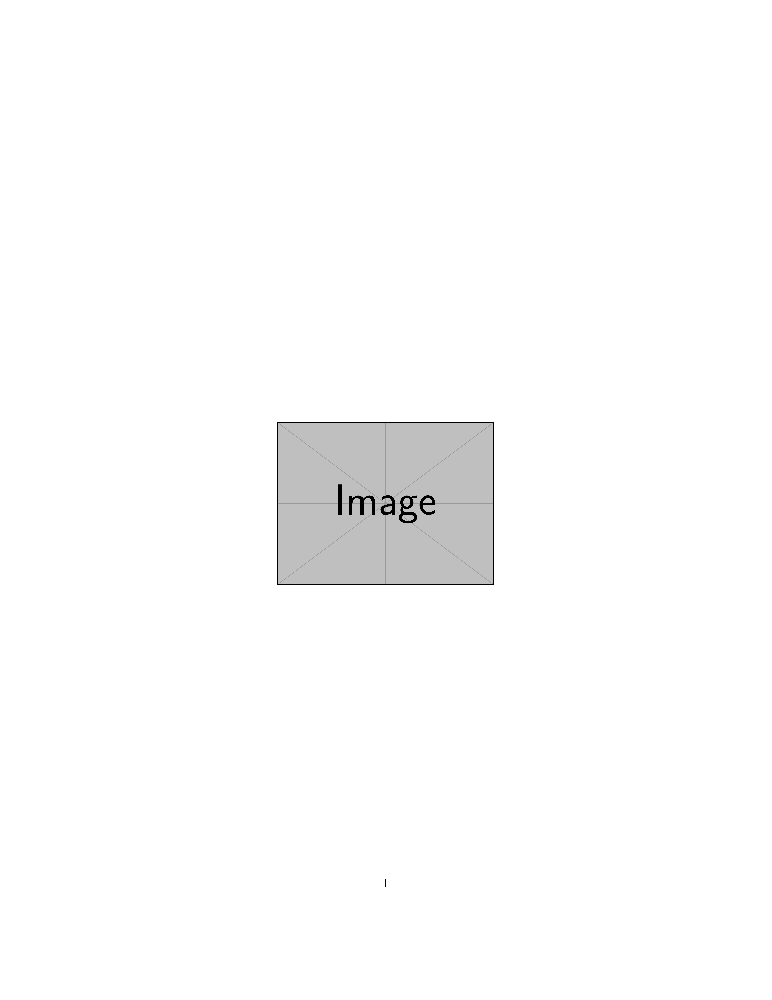
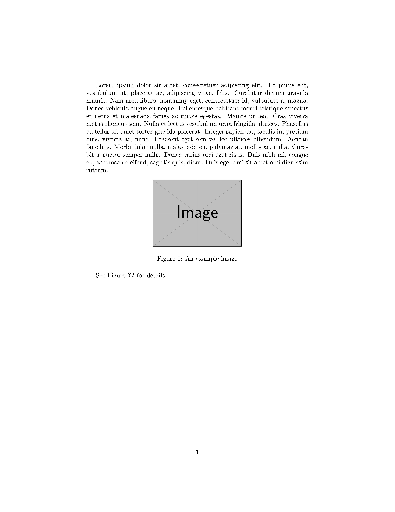
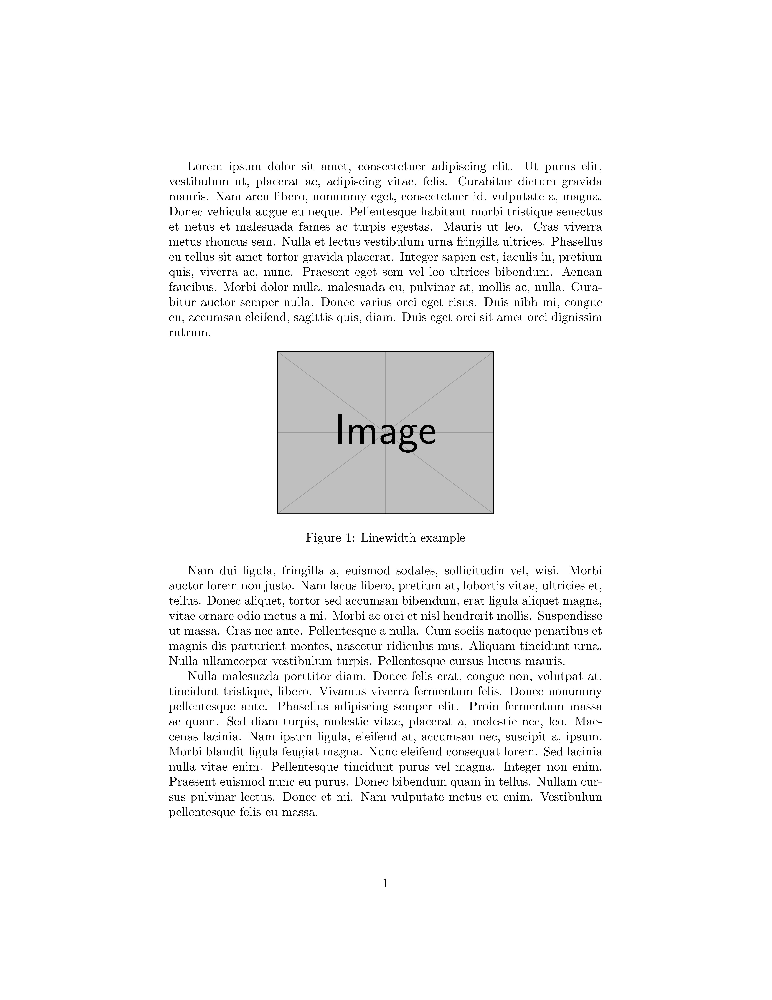

---
## Author
author:
  name: Ван Яо
  degrees: MSc
  email: 1132259420@rudn.ru
  affiliation:
    - name: Российский университет дружбы народов
      department: Группа НФИмд-01-25
      country: Российская Федерация
      postal-code: 117198
      city: Москва
      address: ул. Миклухо-Маклая, д. 13

## Title
title: "Лабораторная работа №4"
subtitle: "Включение графики в LaTeX"
license: "CC BY"
---

# Введение

## Актуальность

Современные научные и технические документы редко обходятся без графических материалов. Иллюстрации, графики и схемы помогают наглядно представить результаты работы, облегчая их восприятие читателем. Поэтому освоение вставки и оформления изображений в LaTeX является важным этапом подготовки к написанию научных работ.

## Цель работы

Изучить способы включения графических изображений в документ LaTeX с помощью пакета `graphicx`, освоить настройку внешнего вида изображений, работу с плавающими объектами, а также механизм перекрёстных ссылок.

## Задачи

1. Изучить базовые команды включения графики (`\includegraphics`).
2. Освоить изменение параметров изображений (размер, обрезка, поворот).
3. Изучить работу с плавающими объектами (floats) и их размещением.
4. Изучить механизм перекрёстных ссылок (`\label` и `\ref`).
5. Изучить особенности хранения графики в подкаталогах.

## Объект и предмет исследования

Объектом исследования является процесс вёрстки документов в LaTeX. Предметом исследования выступают пакеты и команды для работы с графикой.

## Методы исследования

В работе использовались экспериментальные методы: написание тестовых `.tex` файлов, их компиляция в движке `pdfLaTeX` и визуальный анализ полученных PDF-документов.

## Схема выполнения работы

На рис. -@fig-flowchart представлена общая последовательность действий при выполнении работы.


```{mermaid}
%%| fig-width: 100%
graph TD
    A@{ shape: circle, label: "Начало" } --> B[Подключить пакет graphicx]
    B --> C[Добавить изображение через includegraphics]
    C --> D[Настроить параметры (размер, обрезка)]
    D --> E[Поместить изображение в окружение figure]
    E --> F[Добавить метки и ссылки label/ref]
    F --> G[Скомпилировать документ]
    G --> J@{ shape: dbl-circ, label: "Конец" }
```

Блок-схема выполнения лабораторной работы


# Теоретическая часть

Для включения графики в LaTeX используется пакет `graphicx`, который добавляет команду `\includegraphics`. Данный пакет поддерживает форматы EPS, PNG, JPG и PDF [@graphicx_doc].

По умолчанию `\includegraphics` вставляет изображение в его естественном размере, что часто неудобно. Пакет позволяет управлять шириной (`width`), высотой (`height`) и масштабом (`scale`). Для сохранения пропорций достаточно задать только один параметр. Также доступна обрезка (`trim`, `clip`) и поворот (`angle`).

Обычно графику не вставляют прямо в текст, а используют так называемые «плавающие объекты» (floats) — например, окружение `figure`. LaTeX автоматически размещает такие объекты в наиболее подходящем месте страницы, чтобы избежать больших пустых пробелов, при этом сохраняя нумерацию и подписи [@lshort].

Для ссылок на рисунки в тексте используется механизм `\label` и `\ref`, который требует как минимум двух проходов компиляции для разрешения ссылок. Для превращения ссылок в кликабельные используется пакет `hyperref` [@hyperref_doc].


# Выполнение лабораторной работы

1. **Базовое включение (4.1-basic.tex)**. Подключили пакет `graphicx` и вставили тестовое изображение с фиксированной высотой (рис. -@fig-001).

```tex
\documentclass{article}
\usepackage[T1]{fontenc}
\usepackage{graphicx}
\begin{document}
This picture
\begin{center}
\includegraphics[height=2cm]{example-image}
\end{center}
is an imported PDF.
\end{document}
```

{#fig-001 width=70%}

2. **Изменение размера (4.1-size.tex)**. Использовали параметры `height` и `width` относительно размеров текстового блока (рис. -@fig-002).

```tex
\begin{center}
\includegraphics[height=0.5\textheight]{example-image}
\end{center}
Some text
\begin{center}
\includegraphics[width=0.5\textwidth]{example-image}
\end{center}
```

{#fig-002 width=70%}

3. **Обрезка (4.1-trim.tex)**. Применили параметры `clip` и `trim` для обрезки краев изображения (рис. -@fig-003).

```tex
\begin{center}
\includegraphics[clip, trim = 0 0 50 50]{example-image}
\end{center}
```

{#fig-003 width=60%}

4. **Поворот (4.1-rotate.tex)**. Повернули изображение на 45 градусов с помощью параметра `angle` (рис. -@fig-004).

```tex
\begin{center}
\includegraphics[angle=45, width=0.4\textwidth]{example-image}
\end{center}
```

{#fig-004 width=50%}

5. **Плавающие объекты (4.2-float.tex)**. Изображение помещено в окружение `figure` с параметром `[ht]` и добавлена подпись (рис. -@fig-005).

```tex
\begin{figure}[ht]
\centering
\includegraphics[width=0.5\textwidth]{example-image-a.png}
\caption{An example image}
\end{figure}
```

{#fig-005 width=70%}


6. **Именование файлов (4.3-naming.tex)**. Проверили работу с именами файлов и относительными путями (рис. -@fig-006).

```tex
\includegraphics[width=30pt]{pix/mom.png}
```

{#fig-006 width=50%}

7. **Хранение в подкаталоге (4.4subdir.tex)**. Настроили пути поиска изображений с помощью `\graphicspath` (рис. -@fig-007).

```tex
\graphicspath{{figs/}{pics/}}
\includegraphics[width=0.5\textwidth]{example-image}
```

{#fig-007 width=60%}

8. **Строгое размещение (4.6-H.tex)**. Использовали пакет `float` и параметр `[H]`, чтобы изображение оставалось ровно там, где указано в коде (рис. -@fig-008).

```tex
\usepackage{float}
...
\begin{figure}[H]
\centering
\includegraphics[width=0.5\textwidth]{example-image}
\caption{An example image}
\end{figure}
```

{#fig-008 width=70%}

9. **Пользовательские floats (4.7-trivfloat.tex)**. Создали новый тип плавающего окружения с помощью пакета `trivfloat` (рис. -@fig-009).

```tex
\usepackage{trivfloat}
\trivfloat{image}
...
\begin{image}
\centering
\includegraphics[width=0.5\textwidth]{example-image}
\caption{An example image}
\end{image}
```

{#fig-009 width=70%}

10. **Перекрёстные ссылки (4.8-ref.tex)**. Реализовали ссылки на подразделы и уравнения. Потребовалось двойное прохождение компилятора (рис. -@fig-010).

```tex
\subsection{Subsection of the first section}
\label{subsec:labelone}
...
\begin{equation}
e^{i\pi}+1 = 0
\label{eq:labeltwo}
\end{equation}
In subsection~\ref{subsec:labelone} is equation~\ref{eq:labeltwo}.
```

{#fig-010 width=70%}

11. **Ссылки на рисунки (4.8-fig-ref.tex)**. Связали текст с плавающим объектом, разместив `\label` внутри окружения `figure` (рис. -@fig-011).

```tex
\begin{figure}[ht]
\centering
\includegraphics[width=0.4\textwidth]{example-image}
\caption{An example image}
\label{fig:example}
\end{figure}
See Figure~\ref{fig:example} for details.
```

{#fig-011 width=70%}

12. **Гиперссылки (4.8-hyperref.tex)**. Подключили пакет `hyperref` для создания кликабельных перекрёстных ссылок (рис. -@fig-012).

```tex
\usepackage[hidelinks]{hyperref}
...
Some exciting text with a reference~\ref{sec:next}.
```

{#fig-012 width=70%}

13. **Упражнения (4.9-exercises.tex)**. Выполнили дополнительные задания: сравнили `\textwidth` и `\linewidth`, исследовали размещение плавающих объектов с разными параметрами и добавили новые нумерованные части (рис. -@fig-013).

```tex
\includegraphics[width=0.5\linewidth]{example-image}
```

{#fig-013 width=70%}


# Заключение

В ходе работы мы изучили основные средства работы с графикой в LaTeX:

- базовое включение изображений с помощью пакета `graphicx` и команды `\includegraphics`;
- управление размером, обрезкой и поворотом графики;
- использование плавающих окружений `figure` и пакета `float` для управления размещением;
- создание перекрёстных ссылок с помощью `\label` и `\ref`, а также пакета `hyperref`.

# Список литературы {.unnumbered}

::: {#refs}
:::

